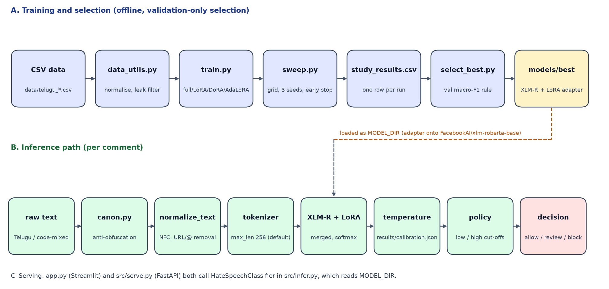
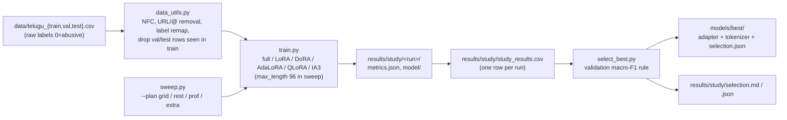
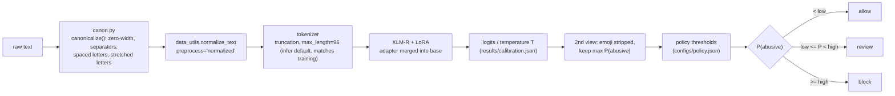
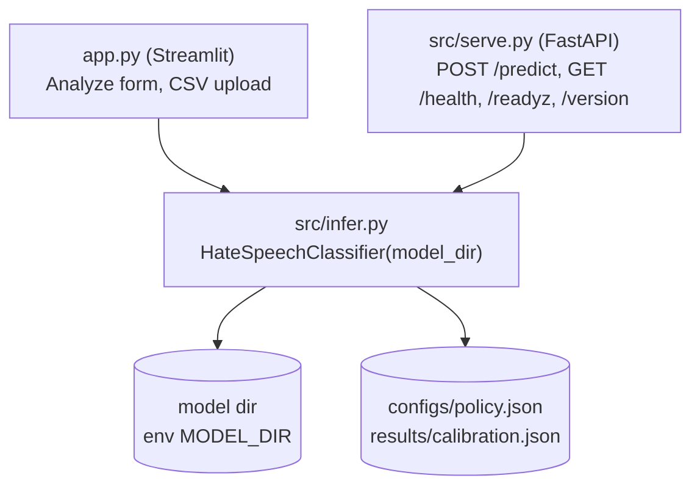

# Architecture

## 1. System overview

This repository contains a classifier for abusive Telugu and code-mixed comments. The final model is XLM-RoBERTa-base (`FacebookAI/xlm-roberta-base`) with a LoRA adapter (r=8, alpha=64, target modules `query` and `value`, dropout 0.05), stored in `models/best/`. The adapter is loaded onto the base model at runtime. Each comment is canonicalised against obfuscation, normalised, tokenised, scored, temperature-scaled, and mapped to one of three decisions (allow, review, block) using thresholds from `configs/policy.json`. The same `HateSpeechClassifier` is used by the Streamlit demo (`app.py`) and the FastAPI service (`src/serve.py`).

## 2. Diagrams

### 2a. Training and experiment pipeline

### 2b. Inference path (one comment)

### 2c. Serving

## 3. Components

| File | Responsibility | Key inputs | Key outputs |
|---|---|---|---|
| `src/data_utils.py` | Load CSVs, label remap (raw 0=abusive to internal 1=abusive), NFC/URL/mention cleanup, dedupe, drop val/test texts that appear in train | `data/*.csv`, `preprocess` level | pandas DataFrame `text,label`; HF `DatasetDict` |
| `src/canon.py` | Deterministic anti-obfuscation rules (zero-width chars, separators inside words, spaced letters, stretched letters) | raw string | cleaned string, list of rules that fired |
| `src/text_mask.py` | Display-only masking of abusive words in logs and exports; never applied to model input | string | masked string |
| `src/train.py` | One training run: full FT or PEFT (LoRA, QLoRA, AdaLoRA, DoRA, IA3); Trainer with per-epoch eval, best-by-macro-F1, optional early stop | `--model --method --lora_r --lora_alpha --lr --epochs --seed` | `results/<run>/metrics.json`, `model/`, confusion matrix, report |
| `src/sweep.py` | Runs `train.py` for a named plan or a raw arg string; logs failures to `errors.log`; appends a row to `study_results.csv` | `--plan {grid,rest,prof,extra}` or `--raw` | `results/study/<run>/`, `study_results.csv` |
| `src/select_best.py` | Groups runs by config, keeps configs with >=3 seeds, applies the validation-only tie-break rule, copies the winner's adapter to `models/best/` | `study_results.csv`, run `metrics.json` | `selection.json`, `selection.md`, `models/best/*` |
| `src/export_best.py` | Merges one study adapter into its base, saves HF fp32, fp32 ONNX and int8 ONNX, benchmarks CPU latency and agreement | `--run`, `--out` | `<out>/hf`, `<out>/onnx`, `<out>/onnx_int8`, `export_metrics.json` |
| `src/export_onnx.py` | Exports an HF or PEFT model to ONNX via optimum; optional per-tensor dynamic int8 (`--quantize`) | `--model_dir`, `--out_dir` | ONNX folder, `*_int8` folder |
| `src/calibration.py` | Temperature scaling (single T, LBFGS, NLL) on validation logits; ECE and Brier before/after | `--model_dir`, validation split | `results/calibration.json` |
| `src/finalize.py` | `threshold_sweep()` grid over (low, high); `main()` picks the best-scoring run by val F1 and writes `final_summary.json`, `policy.json` | study `metrics.json` files, model dir | `results/threshold_sweep.csv`, `configs/policy.json`, `results/final_summary.json` |
| `src/set_policy.py` | Fits allow/review/block thresholds for `models/best` on validation only, requiring block precision >= 0.9 | model dir (default `models/best`) | `configs/policy.json`, `results/threshold_sweep.csv` |
| `src/infer.py` | `HateSpeechClassifier`: loads adapter/merged/ONNX model, runs canon, normalise, tokenise, softmax with T, emoji second view, decision; `explain()` does word-occlusion attribution | `model_dir`, texts | list of dicts: `label`, `probability`, `probs`, `decision`, `review_required` |
| `src/serve.py` | FastAPI wrapper around the classifier | env `MODEL_DIR`, `BASE_MODEL_FOR_ADAPTER`, `MAX_BATCH`=64, `MAX_TEXT_CHARS`=2000 | JSON from `/predict`; `/readyz` runs a real inference |
| `app.py` | Streamlit demo: verdict card, blurred flagged words (via `explain()`), CSV scoring, system-overview tab | env `MODEL_DIR`, `BASE_MODEL_FOR_ADAPTER` | HTML/Streamlit UI; CSV download |
| `src/architecture.py` | Builds the Mermaid diagrams and the "design decisions" cards shown in the app; reads numbers from `results/*.json` | results files | HTML strings |

## 4. Experiment methodology

- **Data.** Only the Telugu split is present in `data/` (`telugu_train/val/test.csv`). The code-mixed CSVs are deleted in the working tree, so `--domain codemixed` cannot run from this checkout. The sweep plans use `--domain telugu`.
- **Seeds.** Each run calls `set_seed(seed)`. The sweep plans use seeds 42, 123 and 2024. Only configs with at least 3 seeds enter selection (`MIN_SEEDS = 3`).
- **Training schedule.** Per-epoch evaluation and checkpointing; `load_best_model_at_end=True` with `metric_for_best_model="macro_f1"`; cosine LR schedule; 10% warm-up steps; weight decay 0.01; batch size 16; `max_length` 96 for sweep runs. Early stopping (patience 3) is enabled by the sweep's `COMMON` arguments. The LoRA study run used for `models/best` stopped with best epoch 6 of 10 (`models/best/metrics.json`).
- **Selection rule** (`src/select_best.py`, written to `results/study/selection.md`):
  1. Group runs by (model, method, lr, epochs, and lora_r/alpha for PEFT).
  2. Keep configs with at least 3 seeds.
  3. Compute mean and sample SD of validation macro-F1 for each config.
  4. Take the config with the highest mean validation macro-F1 (`top`).
  5. Tie set: configs whose mean validation F1 is at least `top.mean - top.SD`.
  6. Winner: the tie-set member with the fewest trainable parameters (ties broken by higher mean validation F1).
  7. Winner run: the seed of that config with the highest validation F1.
- **Validation-only.** Selection uses validation macro-F1 only. Test metrics are written to `selection.md` for reporting and are never read by `select_best.py` for selection. `finalize.py` reads test metrics only for the already-selected run. Note that `train.py` also reports test metrics on every run.
- **Current outcome** (`results/study/selection.md`): top config is XLM-R full FT (val 0.9040 ± 0.0011). The tie-set winner is XLM-R LoRA r8 alpha64 lr 2e-4 e10 (val 0.9035 ± 0.0043, 887,042 trainable parameters, n=3). The run copied to `models/best` is `xlm-roberta-base_lora_r8_a64_lr2e-4_e10_s2024` (run val 0.9073, test 0.9042).
- **Thresholds.** `set_policy.py` searches `low` and `high` on validation probabilities. It keeps settings with block precision >= 0.9 and then maximises block recall, with lower review percentage as the tie-breaker. The current `configs/policy.json` is `{low: 0.45, high: 0.5}`.

## 5. Artifact map

| Path | Produced by | Contents |
|---|---|---|
| `results/<run>/` | `train.py` (default `--output_root results`) | Legacy single runs: `metrics.json`, `model/`, report, confusion matrix |
| `results/study/<run>/` | `sweep.py` / `train.py` | Study runs: `metrics.json`, `log_history.json`, `model/` (adapter or full model) |
| `results/study/study_results.csv` | `sweep.py` (`append_row`) | 44 rows, one per completed run |
| `results/study/errors.log` | `sweep.py` | Tail of stdout/stderr for failed runs |
| `results/study/selection.json`, `selection.md` | `select_best.py` | Rule, ranking, tie set, winner |
| `results/study/summary.md`, `prof_table.csv` | `aggregate_study.py` (not re-read here) | Aggregated tables |
| `models/best/` | `select_best.py` | `adapter_model.safetensors`, `adapter_config.json`, tokenizer files, `metrics.json`, `selection.json` |
| `results/calibration.json` | `calibration.py` | Temperature T (currently 1.334), ECE/Brier before and after, reliability bins |
| `results/threshold_sweep.csv` | `finalize.py`, `set_policy.py` | Grid of (low, high) with block precision/recall and review % |
| `configs/policy.json` | `set_policy.py` or `finalize.py` | Current `{low: 0.45, high: 0.5}` |
| `configs/targets.json` | hand-written | `target_modules` per backbone (`query,key,value` for each) |
| `results/final_summary.json` | `finalize.py` | Summary that `app.py` reads for the default run name |
| `results/final_lora/` | `export_best.py` (earlier export) | Merged HF model, ONNX and int8 ONNX variants, `export_metrics.json` |
| `onnx_model_muril_int8/` | Producer not verified (`export_onnx.py --quantize` is the likely source) | MuRIL int8 ONNX; see Section 6 |
| `docs/figures/` | Study figures (producer `make_figures.py`, not read in full); `architecture.png` from a one-off matplotlib script | Figures |
| `results/final_best/` | `export_best.py` (run for the selected model) | Merged HF model, fp32 ONNX, per-channel INT8 ONNX, `export_metrics.json` |

## 6. Known limitations

1. **Base model download at load time.** The adapter stores `base_model_name_or_path = FacebookAI/xlm-roberta-base`. `HateSpeechClassifier` loads that base from the Hugging Face Hub (or local cache) before applying the adapter. `models/best/` alone is not self-contained, and the service needs network access or a pre-populated cache on first start.
2. **Inference max length** is now 96, matching training (`infer.py` default changed; it was 256 earlier in this study).
3. **Calibration and policy are global.** `infer.py` loads `configs/policy.json` and `results/calibration.json` regardless of which model directory is used. Neither file records which model it was fitted on. `calibration.py` also does not apply `canon.py` before fitting, while `infer.py` does, so the temperature is fitted on slightly different inputs. Timestamps suggest both files were written after `models/best` was selected, but this could not be confirmed from the code.
4. **Default model paths** (`app.py`, `serve.py`) now point at `models/best`.
5. **INT8 quantisation is broken in the committed artifact.** The committed `onnx_model_muril_int8/` uses per-tensor dynamic int8, which collapses predictions (see `docs/PEFT_STUDY_REPORT.md` section 6). Per-channel variants are documented there but are not what `onnx_model_muril_int8/` contains.
6. **ONNX path** for `models/best` is exported at `results/final_best/onnx_int8` (see `docs/DEPLOYMENT.md`).
7. **Data scope.** Only the Telugu CSVs are present in `data/`. Code-mixed experiments cannot be reproduced from this checkout.
8. **Latency of explanations.** `explain()` runs one forward pass per word (up to 80 words) and is called on every Analyze click in `app.py`. It is not used by `serve.py`.
9. **Single-process state.** `serve.py` keeps one classifier in a module global. Inference is synchronous, and there is no request queue or per-request timeout.
10. **Results are from one dataset and three seeds.** See `docs/PEFT_STUDY_REPORT.md` section 7.

## 7. What was not verified

- The adapter was not loaded or run in this session, so the claim that `models/best` produces predictions at runtime is based on reading the code and on the saved `metrics.json` only.
- Whether `configs/policy.json` and `results/calibration.json` were produced from `models/best` (see limitation 3).
- The `errors.log` contents were not analysed; failed runs are not counted here.
- `src/aggregate_study.py`, `src/make_figures.py` and `src/metrics_utils.py` were only skimmed for the artifact map and the `macro_f1` metric key.
