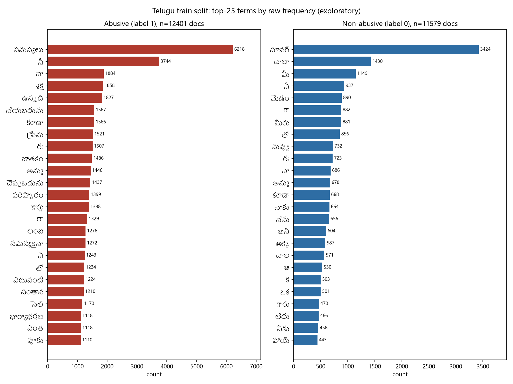
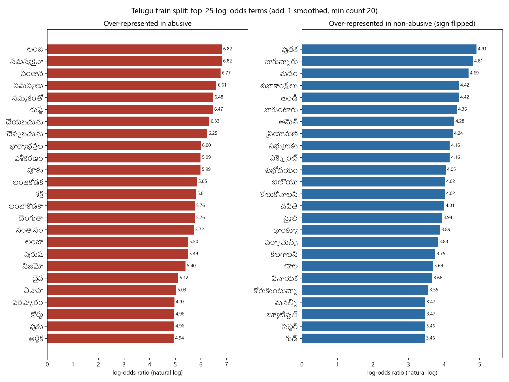

# Lexical Analysis: Telugu Train Split

Exploratory word-frequency analysis, reproducing the lexical view of the Indonesian hate-speech paper for Telugu. It is exploratory lexical evidence, not a model explanation. Source: `load_split('telugu', 'train', 'normalized')` only. Labels: 1 = Abusive, 0 = Non-abusive.

## Method

- Documents: 12401 abusive, 11579 non-abusive (after dedup in `data_utils`).
- Tokens: 183,115 abusive, 119,215 non-abusive.
- Tokenisation: `<number>` placeholders removed; emoji, punctuation, digits and ZWJ/ZWNJ joiners removed; whitespace split; Telugu script (U+0C00-U+0C65) and Latin kept; Latin lowercased.
- No stopword removal, no stemming.
- Log-odds: per term `ln((a+1)/(N_abu+V)) - ln((b+1)/(N_non+V))`, where a and b are the term's counts per class, V is the vocabulary size, and terms need total count >= 20.
- Font for Telugu glyphs in figures: Nirmala UI (C:\Windows\Fonts\Nirmala.ttc).
- Word clouds were not produced because the `wordcloud` package is not installed; horizontal bar charts are used instead.

## Figures

## Top 25 terms by raw frequency

### Abusive (label 1)

| rank | term | count (abusive) | count (non-abusive) |
|---|---|---|---|
| 1 | సమస్యలు | 6218 | 5 |
| 2 | నీ | 3744 | 937 |
| 3 | నా | 1884 | 686 |
| 4 | శక్తి | 1858 | 3 |
| 5 | ఉన్నది | 1827 | 28 |
| 6 | చేయబడును | 1567 | 1 |
| 7 | కూడా | 1566 | 668 |
| 8 | ప్రేమ | 1521 | 164 |
| 9 | ఈ | 1507 | 723 |
| 10 | జాతకం | 1486 | 9 |
| 11 | అమ్మ | 1446 | 678 |
| 12 | చెప్పబడును | 1437 | 1 |
| 13 | పరిష్కారం | 1399 | 6 |
| 14 | కోర్టు | 1388 | 6 |
| 15 | రా | 1329 | 291 |
| 16 | లంజ | 1276 | 0 |
| 17 | సమస్యకైనా | 1272 | 0 |
| 18 | ని | 1243 | 286 |
| 19 | లో | 1234 | 856 |
| 20 | ఎటువంటి | 1224 | 11 |
| 21 | సంతాన | 1210 | 0 |
| 22 | సెల్ | 1170 | 8 |
| 23 | భార్యాభర్తల | 1118 | 1 |
| 24 | ఎంత | 1118 | 222 |
| 25 | పూకు | 1110 | 1 |

### Non-abusive (label 0)

| rank | term | count (non-abusive) | count (abusive) |
|---|---|---|---|
| 1 | సూపర్ | 3424 | 234 |
| 2 | చాలా | 1430 | 226 |
| 3 | మీ | 1149 | 891 |
| 4 | నీ | 937 | 3744 |
| 5 | మేడం | 890 | 50 |
| 6 | గా | 882 | 551 |
| 7 | మీరు | 881 | 374 |
| 8 | లో | 856 | 1234 |
| 9 | నువ్వు | 732 | 896 |
| 10 | ఈ | 723 | 1507 |
| 11 | నా | 686 | 1884 |
| 12 | అమ్మ | 678 | 1446 |
| 13 | కూడా | 668 | 1566 |
| 14 | నాకు | 664 | 351 |
| 15 | నేను | 656 | 452 |
| 16 | అని | 604 | 563 |
| 17 | అక్క | 587 | 204 |
| 18 | చాల | 571 | 19 |
| 19 | ఆ | 530 | 422 |
| 20 | కి | 503 | 665 |
| 21 | ఒక | 501 | 398 |
| 22 | గారు | 470 | 64 |
| 23 | లేదు | 466 | 481 |
| 24 | నీకు | 458 | 824 |
| 25 | హాయ్ | 443 | 32 |

## Top 25 terms by log-odds

Restricted to terms with total count >= 20. Log-odds is signed: positive = over-represented in abusive, negative = over-represented in non-abusive. The figure shows the non-abusive side as absolute values.

### Over-represented in abusive

| rank | term | log-odds | count (abusive) | count (non-abusive) |
|---|---|---|---|---|
| 1 | లంజ | 6.821 | 1276 | 0 |
| 2 | సమస్యకైనా | 6.818 | 1272 | 0 |
| 3 | సంతాన | 6.768 | 1210 | 0 |
| 4 | సమస్యలు | 6.612 | 6218 | 5 |
| 5 | నమ్మకంతో | 6.480 | 907 | 0 |
| 6 | దుష్ట | 6.470 | 898 | 0 |
| 7 | చేయబడును | 6.333 | 1567 | 1 |
| 8 | చెప్పబడును | 6.246 | 1437 | 1 |
| 9 | భార్యాభర్తల | 5.995 | 1118 | 1 |
| 10 | వశీకరణం | 5.993 | 557 | 0 |
| 11 | పూకు | 5.988 | 1110 | 1 |
| 12 | లంజకోడక | 5.846 | 481 | 0 |
| 13 | శక్తి | 5.810 | 1858 | 3 |
| 14 | లంజాకొడకా | 5.762 | 442 | 0 |
| 15 | దెంగుతా | 5.762 | 442 | 0 |
| 16 | సంతానం | 5.723 | 425 | 0 |
| 17 | లంజా | 5.499 | 680 | 1 |
| 18 | పురుష | 5.493 | 676 | 1 |
| 19 | నిజమో | 5.403 | 927 | 2 |
| 20 | దైవ | 5.116 | 928 | 3 |
| 21 | వివాహ | 5.034 | 213 | 0 |
| 22 | పరిష్కారం | 4.967 | 1399 | 6 |
| 23 | కోర్టు | 4.959 | 1388 | 6 |
| 24 | పుకు | 4.957 | 197 | 0 |
| 25 | ఆర్థిక | 4.941 | 194 | 0 |

### Over-represented in non-abusive

| rank | term | log-odds | count (abusive) | count (non-abusive) |
|---|---|---|---|---|
| 1 | పుడక | -4.911 | 1 | 194 |
| 2 | బాగున్నారు | -4.809 | 0 | 87 |
| 3 | మెడం | -4.688 | 0 | 77 |
| 4 | శుభాకాంక్షలు | -4.420 | 2 | 178 |
| 5 | అండీ | -4.418 | 1 | 118 |
| 6 | బాగుంటారు | -4.357 | 1 | 111 |
| 7 | అమెన్ | -4.283 | 0 | 51 |
| 8 | ప్రియామణి | -4.244 | 0 | 49 |
| 9 | సభ్యులకు | -4.160 | 0 | 45 |
| 10 | ఎక్స్లెంట్ | -4.160 | 0 | 45 |
| 11 | శుభోదయం | -4.045 | 0 | 40 |
| 12 | ఐలౌయు | -4.020 | 0 | 39 |
| 13 | కోలుకోవాలని | -4.020 | 0 | 39 |
| 14 | చవితి | -4.008 | 1 | 78 |
| 15 | స్మైల్ | -3.943 | 0 | 36 |
| 16 | థాంక్యూ | -3.887 | 2 | 104 |
| 17 | పర్ఫామెన్స్ | -3.828 | 0 | 32 |
| 18 | కలగాలని | -3.749 | 1 | 60 |
| 19 | చాల | -3.685 | 19 | 571 |
| 20 | వినాయక | -3.664 | 2 | 83 |
| 21 | కోరుకుంటున్నా | -3.550 | 0 | 24 |
| 22 | మనల్ని | -3.467 | 0 | 22 |
| 23 | బ్యూటిఫుల్ | -3.467 | 3 | 91 |
| 24 | సిస్టర్ | -3.460 | 5 | 136 |
| 25 | గుడ్ | -3.457 | 16 | 386 |

## Observations

Raw frequency is led by a small set of high-frequency tokens shared across both classes, including possessive pronouns, the particle meaning 'also', and a generic noun meaning 'problems', so the raw view separates the classes only weakly. The log-odds view surfaces more contrastive terms: the abusive side is enriched for profane terms and for terms tied to astrology, spells, marriage and family matters, and court cases, while the non-abusive side is enriched mostly for greetings and well-wishes (for example 'good morning', 'best wishes' and 'thank you'). Because Telugu is agglutinative and no stemming was applied, inflected forms of one stem are counted separately, so these rankings understate the true size of each theme. This is exploratory frequency evidence only: it describes which surface strings co-occur with each label in the training split and does not show how the model uses them.

## Caveats

- Agglutination: surface forms dominate; no stemming or morphological analysis.
- Emoji and joiners were removed, so emoji-only signal is not represented.
- Spelling variants are separate terms (for example two spellings of one profane term both appear in the abusive log-odds list), so per-term counts are split across variants.
- Log-odds with add-1 smoothing is unstable for rare terms; the min-count threshold limits this.
- Train split only; val and test were not inspected.
