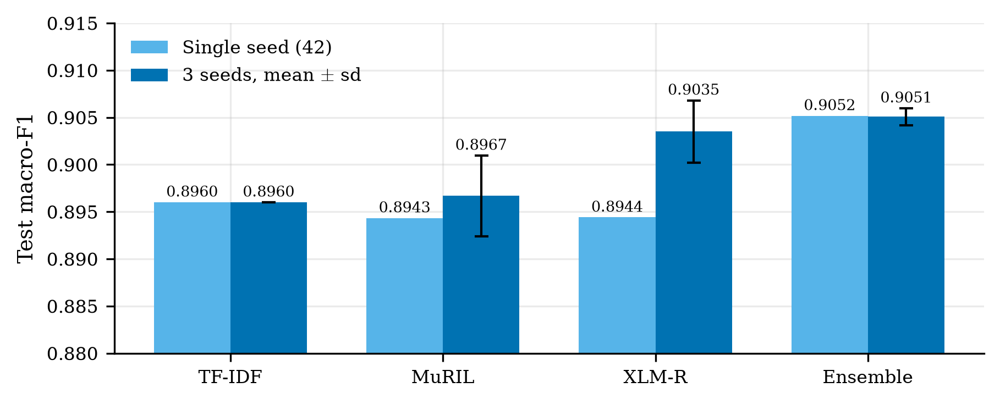
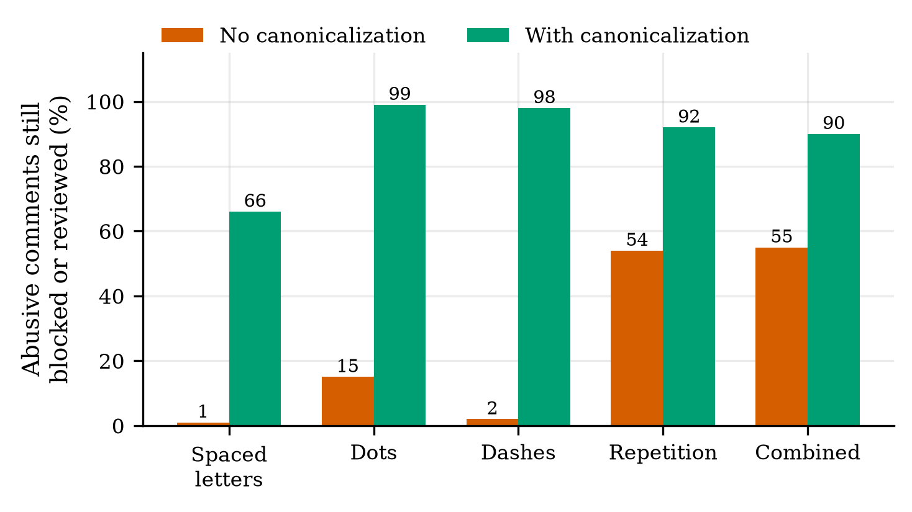
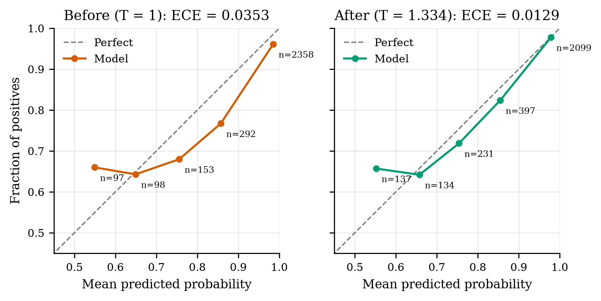
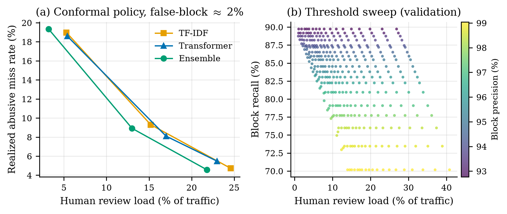

# Backbones, Obfuscation Defence and Review Policy for Telugu Abusive-Comment Detection

*Draft. All numbers are copied from committed reports (`ACADEMIC_RESEARCH_REPORT.md`, `ROBUSTNESS.md`, `SEEDS_RELABEL_REPORT.md`, `POLICY_REPORT.md`, `PEFT_STUDY_REPORT.md`, `MODEL_CARD.md`) or read from `results/`. Figures are regenerated by `src/generate_paper_figures.py` (PDF in `docs/figures/` for LaTeX, 300 dpi PNG for this file). Labels, functional cases and augmentation templates written by a model are not native-speaker verified (see §7).*

## Abstract

We study binary abusive-comment detection for Telugu-script text and ask what actually moves the metric. On a de-spammed split (test n = 2,770), a TF-IDF + LinearSVC baseline (macro-F1 0.8960) is statistically tied with MuRIL-base (0.8943) and XLM-R-base (0.8944) fine-tuned with LoRA+; a TF-IDF + MuRIL ensemble reaches 0.9052, but its paired-bootstrap 95% CI against TF-IDF includes zero. Across three seeds the seed standard deviation (0.0035 to 0.0043 for MuRIL) is as large as most effects we measured. Parameter-efficient variants do not help: DoRA matches LoRA within seed noise and AdaLoRA is about 1.5 points worse. Three components do change behaviour: (i) a Dravidian-aware canonicalizer raises the share of obfuscated abusive comments still caught from 1-55% to 66-99% at no measurable cost on clean text; (ii) temperature scaling cuts expected calibration error from 0.0353 to 0.0129; (iii) a class-conditional conformal allow/review/block policy holds the wrongful-block rate near 2% while exposing the review-load / miss-rate trade-off. We report out-of-domain degradation (code-mixed zero-shot 0.76) and the limits of our model-authored evaluation material.

## 1. Introduction

Abusive-comment moderation for Telugu is under-resourced: few labelled corpora, noisy labels, and an adversarial setting in which users disguise slurs with spacing, separators and stretched letters. Most published work compares fine-tuned multilingual encoders on a single split and a single seed. Two questions are rarely answered: whether the reported gaps exceed seed variance, and whether the deployed system survives cheap obfuscation and supports a calibrated human-review path.

Contributions:
1. A seed- and bootstrap-aware comparison of TF-IDF, MuRIL, XLM-R and their ensemble (§5.1), plus a LoRA / DoRA / AdaLoRA analysis (§4.2).
2. A Dravidian canonicalizer with a measured obfuscation stress test (§4.4, §5.2).
3. Temperature calibration and a conformal three-way policy with realized error rates (§4.3, §5.3, §5.4).
4. An explicit threats-to-validity section, including what we did not verify (§7).

## 2. Formal Problem Formulation

Let x be a Telugu-script comment and y ∈ {0, 1} its label (1 = abusive). A scorer f(x) ∈ [0, 1] estimates P(y = 1 | x). An adversary applies a disguise t ∈ 𝒯 (letter spacing, dots, dashes, repetition, zero-width characters, emoji, leetspeak, case) to produce t(x) with the same meaning. A deployed system composes a canonicalizer c(·), a scorer, and a three-way policy π_{l,h}:

π(p) = allow if p < l; review if l ≤ p < h; block if p ≥ h.

Objectives: (a) macro-F1 of 1[f(c(x)) ≥ 0.5] on clean data; (b) robustness R_t = P(π(f(c(t(x)))) ≠ allow | y = 1) for each t; (c) calibration, ECE = Σ_b (n_b/n)|acc_b − conf_b|; (d) the false-block rate P(block | y = 0) ≤ α and miss rate P(allow | y = 1) ≤ β at minimum review load P(review).

## 3. Data and Protocol

De-spammed Telugu split in `data/clean`; test n = 2,770, validation n = 2,998 for calibration. Metric: macro-F1 at threshold 0.5 unless stated. Out-of-domain probe: a separate code-mixed set (n = 387), never trained on. Seeds: MuRIL 1, 2, 42 (this study); XLM-R PEFT study 42, 123, 2024.

## 4. Methodology

### 4.1 Backbones
- **TF-IDF + LinearSVC**, Platt-calibrated (deterministic, hence no seed variance).
- **MuRIL-base-cased** and **XLM-R-base**, LoRA+ (all-linear, r = 16 for the main runs, loraplus ratio 8, lr 5e-5, 4 epochs, batch 32, max length 128, fp16, early stopping 2).
- **Ensemble**: mean of the Platt-calibrated TF-IDF probability and the transformer probability.

### 4.2 LoRA vs DoRA vs AdaLoRA
XLM-R-base, r = 8, α = 64, lr 2e-4, 3 seeds (42 / 123 / 2024), test macro-F1 (`PEFT_STUDY_REPORT.md` §7b):

| method | macro-F1 (mean ± sd) | trainable params | adapter size |
|---|---|---|---|
| full fine-tuning | 0.9057 ± 0.0033 | 278.0M (100%) | 1061 MB |
| LoRA | 0.9035 ± 0.0033 | 887k (0.32%) | 3.4 MB |
| DoRA | 0.9055 ± 0.0009 | 905k (0.33%) | 3.5 MB |
| AdaLoRA | 0.8891 ± 0.0013 | 1.03M (0.37%) | 4.0 MB |

DoRA vs LoRA is a tie inside seed spread on XLM-R; on MuRIL, DoRA was 0.4-0.5 points lower (val 0.8984 vs 0.9026). AdaLoRA is about 1.5 points lower at roughly twice the training time (1502 s vs 1036 s for DoRA in the single-seed MuRIL run). LoRA trades recall for precision (abusive P / R 0.929 / 0.883 vs 0.914 / 0.905 for full FT). Hyperparameters were tuned for MuRIL + LoRA and reused, which may disadvantage DoRA and AdaLoRA.

### 4.3 Temperature calibration
A single temperature T fitted on validation (n = 2,998) divides the logits: p = σ(z / T). T = 1.334. ECE 0.0353 → 0.0129, Brier 0.0730 → 0.0711 (`results/calibration.json`). The model was over-confident (confidence above accuracy in every populated bin; Fig. 3).

### 4.4 Dravidian canonicalization
`src/canon.py` removes zero-width characters, separators inside words (dots, dashes), letter spacing, and runs of 3+ repeated letters, and maps lookalikes of the anusvara `ం` (Latin o/O, Cyrillic о, Greek ο, Telugu digit zero) when glued to a Telugu letter. Doubled Telugu letters (`నన్ను`, `చచ్చి`) are legitimate, so 2× repeats are deliberately kept. The homoglyph rule has unit self-checks but no measured recovery rate.

### 4.5 Three-way policy
Class-conditional split-conformal thresholds (l, h) with α = 2% wrongful blocks of non-abusive comments and target miss β ∈ {5, 10, 20}%, calibrated on half of validation (n_cal = 1,365); TF-IDF Platt fitted on the other half (n = 1,364).

## 5. Empirical Results

### 5.1 Backbones are statistically tied

| model | single seed | 3 seeds (mean ± sd) |
|---|---|---|
| TF-IDF | 0.8960 | n/a (deterministic) |
| MuRIL (LoRA+) | 0.8943 | 0.8967 ± 0.0043 |
| XLM-R | 0.8944 | 0.9035 ± 0.0033 † |
| TF-IDF + MuRIL | 0.9052 | 0.9051 ± 0.0009 |

† XLM-R 3-seed figure is the LoRA r = 8 study recipe (§4.2), not the lp8 single-seed run, so the two XLM-R entries are different configurations.

**Figure 1.** Test macro-F1 by system, single seed vs three seeds. Error bars are sample sd (n = 3). Y-axis is truncated at 0.88 to make 0.001-scale differences visible; all differences between systems except ensemble-vs-singles are inside one to two seed sd.

Ensemble gain over TF-IDF is +0.0045, paired-bootstrap 95% CI [−0.0038, +0.0131] (10,000 resamples), McNemar p = 0.356. A 2 MB-class linear model matches the transformers, so serving cost should drive the choice. A relabelling experiment (98 train labels changed, TF-IDF only) moved test F1 by +0.0022, CI [−0.0022, +0.0065].

### 5.2 Obfuscation defence

300 abusive test comments, every word disguised, MuRIL. "Caught" = still blocked or sent to review.

| attack | no guard | with guard | clean wrongly blocked |
|---|---|---|---|
| spaced letters | 1% | 66% | 5.0% |
| dots | 15% | 99% | 5.7% |
| dashes | 2% | 98% | 5.3% |
| character repetition | 54% | 92% | 11.7% |
| combined (repeat + ZWJ + emoji) | 55% | 90% | 14.7% |

**Figure 2.** Share of obfuscated abusive comments still caught, before and after canonicalization.

Zero-width, emoji, leetspeak and uppercase attacks were already at 99-100% because MuRIL's tokenizer ignores them. Cost on ordinary text: test macro-F1 0.9048 with the guard vs 0.9045 without. With the XLM-R candidate and the same guard, spaced letters are caught 89% of the time (vs 66%).

### 5.3 Calibration

**Figure 3.** Reliability diagrams on validation (n = 2,998) before and after temperature scaling. Only populated bins are drawn (all predictions fall above 0.5, so the lower half of the diagram is empty by construction); bin sizes annotated. The lowest two bins remain slightly under-confident after scaling.

### 5.4 Review policy

Test, α = 2% wrongful blocks; realized false-block 1.95% (ensemble, transformer) and 2.23% (TF-IDF).

| scorer | target miss β | realized miss | review load |
|---|---|---|---|
| TF-IDF | 5% / 10% / 20% | 4.72 / 9.30 / 18.97% | 24.6 / 15.2 / 5.3% |
| Transformer | 5% / 10% / 20% | 5.47 / 8.10 / 18.59% | 23.0 / 17.0 / 5.4% |
| Ensemble | 5% / 10% / 20% | 4.57 / 8.92 / 19.34% | 21.8 / 13.0 / 3.2% |

**Figure 4.** (a) Realized miss rate against review load for the three scorers; within each curve, points run from β = 20% (left) to β = 10% to β = 5% (right). The ensemble dominates at every β. (b) Validation sweep over (low, high) thresholds for the deployed model, coloured by block precision. Panel (b) is a different scorer, split and policy family from panel (a) and is shown for the shape of the trade-off, not for comparison with (a).

The guarantee is marginal, so a single calibration set scatters around the targets (e.g. transformer β = 5% realizes 5.47%).

### 5.5 Functional behaviour (HateCheck-style, n = 149)
Ensemble pass rate 96.6% ± 0.67 (clean) vs 98.2% ± 0.39 (augmented MuRIL member); negated hate 70% → 93%. Seed ranges do not overlap (98.0-98.7 vs 96.0-97.3), but the cases and templates are model-authored from shared vocabulary, so this gain is in-distribution (§7).

## 6. Related Work

Functional testing follows HateCheck-style suites; SEAHateCheck (Ng et al., 2026) extends this to South-East Asian languages and reports slang, implicit hate and counter-speech as weak spots. Word-level occlusion attribution is the same family as the explainer in X-MuTeST (Rehman et al., 2026). Conformal routing of uncertain items to humans follows Villate-Castillo et al. (2025). Cross-lingual transfer with web-scale ensemble-annotated data (Dang et al., 2026) suggests continued MLM pretraining as a next step; we did not try it.

## 7. Threats to Validity

- **Label provenance.** Gold-sheet relabels, functional cases and augmentation templates were written by a Claude model; none is native-speaker verified. Test labels carry the same noise, so the relabel experiment cannot show whether flips were correct.
- **Template circularity.** The augmentation gain on negated hate is measured on cases from the same template family.
- **Seeds.** Only the MuRIL (3) and PEFT (3) studies use multiple seeds; all other runs are single seed, and n = 3 sample sd is itself noisy. Hyperparameter grids were tuned on MuRIL + LoRA.
- **Mixed recipes in Fig. 1.** XLM-R single-seed and 3-seed bars are different configurations (§5.1 †).
- **Domain shift.** Zero-shot code-mixed macro-F1 is 0.76 and Latin-script comments 0.75, vs 0.90 in-domain. No Romanized test set exists.
- **Attack coverage.** Stress tests use uniform every-word disguise. Letter spacing without word boundaries is caught only 66%; doubling every letter of clean text wrongly blocks 12-15%; star-censored words are treated as abusive (a dataset artifact, ~99% of clean text censored this way is blocked). Implicit, sarcastic and double-meaning abuse was not tested. The homoglyph rule has no measured recovery rate.
- **Calibration.** One temperature fitted on validation; the gap between raw and calibrated probabilities was not analysed further, and ECE with five populated bins is coarse.
- **Policy.** Conformal guarantees are marginal; one calibration set gives realized rates that scatter around targets.
- **Demo mismatch.** `app.py` contains a hard-coded perturbation table that does not match `ROBUSTNESS.md`; the latter is the source of truth.

## 8. References

- Rehman et al. "X-MuTeST: A Multilingual Benchmark for Explainable Hate Speech Detection and a Novel LLM-consulted Explanation Framework." arXiv:2601.03194, AAAI 2026.
- Ng et al. "SEAHateCheck." arXiv:2603.16070, TALLIP, Mar 2026.
- Dang, Mitrovic, Granitzer. "Toward Generalized Cross-Lingual Hateful Language Detection with Web-Scale Data and Ensemble LLM Annotations." arXiv:2604.09625, LREC 2026 submission.
- Villate-Castillo, Del Ser, Sanz. arXiv:2411.04090, Neurocomputing 647 (2025).

*Only the abstracts of the 2026 papers were checked (see `APPROACH_SURVEY.md`); no full text was read. Method references (LoRA, DoRA, AdaLoRA, MuRIL, XLM-R, conformal prediction, temperature scaling) are cited by name only; add bibliographic entries before submission.*
