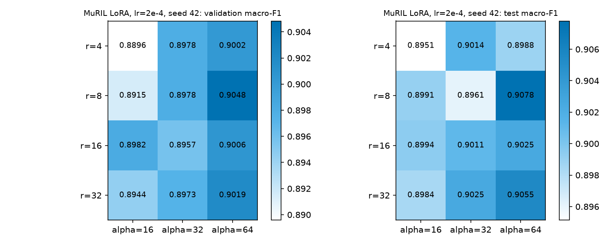

# E3 - MuRIL LoRA rank x alpha grid and lr ablation

| Field | Value |
|---|---|
| Experiment | E3 |
| Status | complete - 14 runs (seed 42 only) |
| n seeds | 1 per cell (seed 42); the reference cell (r=8, alpha=64, lr=2e-4) also has seeds 123 and 2024 in muril_lora |
| Backbone | `google/muril-base-cased` (MuRIL base cased) |
| Method | LoRA on query,value, dropout 0.05, 10 epochs |

## Grid: rank x alpha (lr = 2e-4)

| rank | alpha=16 (val / test) | alpha=32 (val / test) | alpha=64 (val / test) |
|---|---|---|---|
| r=4 | 0.8896 / 0.8951 | 0.8978 / 0.9014 | 0.9002 / 0.8988 |
| r=8 | 0.8915 / 0.8991 | 0.8978 / 0.8961 | 0.9048 / 0.9078 |
| r=16 | 0.8982 / 0.8994 | 0.8957 / 0.9011 | 0.9006 / 0.9025 |
| r=32 | 0.8944 / 0.8984 | 0.8973 / 0.9025 | 0.9019 / 0.9055 |

## Learning-rate ablation (r=8, alpha=64)

| lr | val macro-F1 | test macro-F1 | best epoch | run |
|---|---|---|---|---|
| 0.0001 | 0.8922 | 0.8981 | 10 | lora_r8_a64_lr1e-4_e10_s42 |
| 0.0002 | 0.9048 | 0.9078 | 8 | lora_r8_a64_lr2e-4_e10_s42 |
| 0.0005 | 0.8438 | 0.8422 | 1 | lora_r8_a64_lr5e-4_e10_s42 |

## Trainable parameters per rank

| rank r | trainable params | trainable % | total params |
|---|---|---|---|
| 4 | 148,994 | 0.0627 | 237,706,756 |
| 8 | 296,450 | 0.1246 | 237,854,212 |
| 16 | 591,362 | 0.2483 | 238,149,124 |
| 32 | 1,181,186 | 0.4948 | 238,738,948 |

Identical across alpha within each rank: OK.

Adapter formula check (`layers x 2 x r x 2*hidden` + classifier `2*hidden+2`):

- r=4: formula 148,994 vs recorded 148,994 -> OK
- r=8: formula 296,450 vs recorded 296,450 -> OK
- r=16: formula 591,362 vs recorded 591,362 -> OK
- r=32: formula 1,181,186 vs recorded 1,181,186 -> OK

## Best cell by validation

- Best rank x alpha cell (lr=2e-4): r=8, alpha=64 (val 0.9048, test 0.9078).
- Best of all E3 rows including lr ablation: `lora_r8_a64_lr2e-4_e10_s42` (val 0.9048, test 0.9078).

Seed spread of the 3-seed reference cell (muril_lora), mean ± sample std: val macro-F1 0.9026 ± 0.0020; test macro-F1 0.9052 ± 0.0030.

Caveat: each cell is one seed. Differences smaller than the seed spread above are not distinguishable from seed noise (heuristic, not a significance test).

Hypothesis (not tested): alpha/r scaling (alpha = 4r..16r here) is what moves the grid more than rank alone.

## Artifacts

- `results/study/study_results.csv` (rows with model=google/muril-base-cased, method=lora, seed=42)
- `results/study/lora_r*_a*_lr*_e10_s42/`, `results/study/lora_r8_a64_lr*_e10_s42/`

