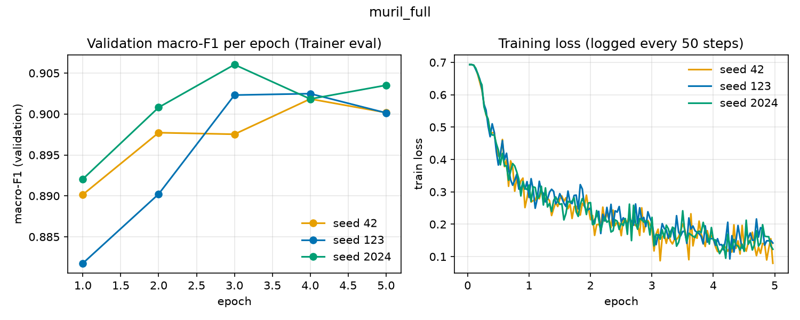
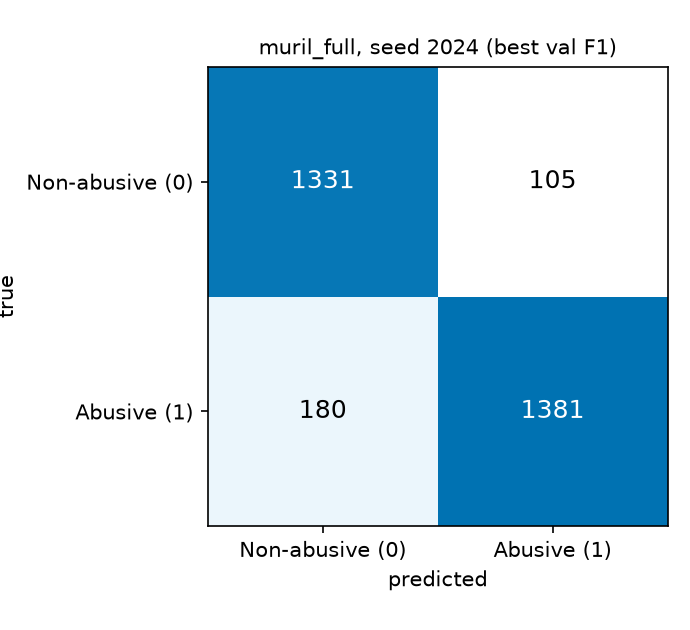

# muril_full

| Field | Value |
|---|---|
| Experiment | extra |
| Status | complete - 3 seed(s) [42, 123, 2024] |
| n seeds | 3 |
| Backbone | `google/muril-base-cased` (MuRIL base cased) |
| Method | Full FT |
| Config | lr=2e-05, epochs=5 |

## 2. Goal

Full fine-tuning is the baseline: every backbone weight and the classification head are updated by AdamW. The other methods are compared against it on the same backbone.

Question answered: what test macro-F1 does full fine-tuning of MuRIL base cased reach at lr=2e-05, 5 epochs?

## 3. Architecture end-to-end

```text
Telugu text (raw)
  |  normalize_text('normalized'): NFC -> mask URLs & @mentions -> collapse spaces  [src/data_utils.py]
  v
Tokenizer, truncation to max_length=96  [src/train.py]
  |
  v
Embeddings: word + position (197,285 x 768)      [TRAINABLE]
  |
  v
Encoder layer x12:
    self-attn query (q):  TRAINABLE  (targets: query,value)
    self-attn key   (k):  TRAINABLE
    self-attn value (v):  TRAINABLE
    self-attn out   (o):  TRAINABLE
    FFN 768->3072->768:    TRAINABLE
    LayerNorm:            TRAINABLE
  |
  v
[CLS] -> pooler dense+tanh (pooler: trainable)
  |
  v
head: classifier Linear(768->2)  [TRAINABLE (all weights are trainable)]
  |
  v
2 logits -> softmax -> argmax -> Non-abusive (0) / Abusive (1)
```

Full fine-tuning: no adapters; all weights and the head are trainable.

| Architecture | Value | Source |
|---|---|---|
| layers | 12 | AutoConfig.num_hidden_layers |
| hidden size | 768 | AutoConfig.hidden_size |
| attention heads | 12 | AutoConfig.num_attention_heads |
| FFN intermediate | 3072 | AutoConfig.intermediate_size |
| vocab size | 197,285 | AutoConfig.vocab_size |
| max positions | 512 | AutoConfig.max_position_embeddings |

Parameter counts across seeds identical: OK.

| Parameters | Value | Source |
|---|---|---|
| total params (metrics.json total_params) | 237,557,762 | metrics.json |
| trainable params | 237,557,762 | metrics.json |
| trainable % | 100.0000 | metrics.json |
| frozen = total - trainable | 0 | derived |
| adapter + head vs trainable | OK (all params trainable) | formula check |

## 4. Training setup

| Setting | Value | Source |
|---|---|---|
| learning rate | 2e-05 | metrics.json hyperparams.lr |
| epochs (configured) | 5 | CSV / metrics.json |
| train batch size | 16 | metrics.json hyperparams.train_bs |
| eval batch size | 64 | training_args.bin |
| max_length | 96 | metrics.json hyperparams.max_length |
| optimizer | adamw_torch | training_args.bin (HF Trainer default; train.py does not set it) |
| weight decay | 0.01 | training_args.bin (train.py sets 0.01) |
| LR schedule | cosine | training_args.bin / metrics.json |
| warmup steps | 749 | training_args.bin (train.py: 10% of total steps, see below) |
| fp16 | True | training_args.bin (train.py: fp16 = CUDA available unless --fp16) |
| early stopping patience | 3 | metrics.json hyperparams |
| grad clip (max_grad_norm) | 1.0 | training_args.bin |
| LoRA r / alpha / dropout / targets | n/a (full FT) |  |
| preprocessing | not recorded in metrics.json | train.py default --preprocess normalized |

Warmup and schedule code: `src/train.py` line ~208 sets warmup_steps = max(1, int(0.1 * total_steps)); line 237 sets weight_decay=0.01; line 239 uses lr_scheduler_type=args.lr_scheduler (default cosine).

## 5. What happened

| seed | best epoch | epochs run / configured | early stop | val macro-F1 | test macro-F1 | train time (s) | peak GPU (MB) |
|---|---|---|---|---|---|---|---|
| 42 | 4 | 5 / 5 | no | 0.9018 | 0.9078 | 1445.8 | 4588.9 |
| 123 | 4 | 5 / 5 | no | 0.9025 | 0.9021 | 1168.3 | 4586.7 |
| 2024 | 3 | 5 / 5 | no | 0.9060 | 0.9049 | 1136.3 | 4583.5 |

Early stopping (epochs run < configured) triggered in 0 of 3 seeds. Epochs run is the last epoch with a Trainer eval entry in log_history.json.



Left: validation macro-F1 per epoch (Trainer eval entries, all seeds). Right: training loss from log_history.json (logged every 50 steps), x-axis in epochs.

## 6. Results

| Metric (test set, mean ± sample std over seeds) | Value |
|---|---|
| accuracy | 0.9050 ± 0.0028 |
| abusive precision | 0.9188 ± 0.0098 |
| abusive recall | 0.8971 ± 0.0109 |
| abusive F1 | 0.9077 ± 0.0029 |
| non-abusive F1 | 0.9021 ± 0.0032 |
| macro-F1 (from CM) | 0.9049 ± 0.0028 |
| weighted-F1 (from CM) | 0.9050 ± 0.0028 |

Consistency: CM-derived macro-F1 vs metrics.json test_macro_f1 per seed: OK, OK, OK.

| seed | test n | TN | FP (pred Abusive, true not) | FN (pred not, true Abusive) | TP | FP/FN |
|---|---|---|---|---|---|---|
| 42 | 2997 | 1308 | 128 | 148 | 1413 | 0.865 |
| 123 | 2997 | 1297 | 139 | 154 | 1407 | 0.903 |
| 2024 | 2997 | 1331 | 105 | 180 | 1381 | 0.583 |

Error counts (mean over seeds): FP = 124.0, FN = 160.7, FP/FN = 0.772. Class 1 = Abusive, confusion matrix layout [[TN,FP],[FN,TP]].

Confusion matrix, seed 2024 (highest validation macro-F1 = 0.9060):



## 7. Compared with baseline

This group is the same-backbone full fine-tune baseline.

## 8. Interpretation

- Test macro-F1 mean 0.9049 over 3 seed(s) (std 0.0028).
- Seed with the highest validation macro-F1: 2024 (val 0.9060, test 0.9049).
- Best epochs by seed: 4, 4, 3.

## 9. Spec alignment

| parameter | ours | paper Table 2 | professor start | match? |
|---|---|---|---|---|
| LoRA rank r | n/a (full FT) | 4 | 16 | paper: n/a; prof: n/a |
| LoRA alpha | n/a (full FT) | 32 | 32 | paper: n/a; prof: n/a |
| LoRA dropout | n/a (full FT) | 0.1 | 0.1 | paper: n/a; prof: n/a |
| train batch size | 16 | 8 | 16 | paper: no; prof: yes |
| max_length | 96 | 128 | 128 | paper: no; prof: no |
| epochs (configured) | 5 | 5 | 5 | paper: yes; prof: yes |
| learning rate | 2e-05 | not specified | 0.0002 | paper: n/a (not in spec); prof: no |
| optimizer | adamw_torch | AdamW | not specified | paper: yes; prof: n/a (not in spec) |
| fp16 | True | True | not specified | paper: yes; prof: n/a (not in spec) |
| target modules | all weights | query,value | not specified | paper: no; prof: n/a (not in spec) |
| weight decay | 0.01 | not specified | 0.01 | paper: n/a (not in spec); prof: yes |

Paper and professor values come from the project spec, not from run artifacts. Paper lr is not specified in the spec.

## 10. Limitations and artifact paths

- Seeds: 3 (42, 123, 2024). Std is over these seeds only; n=1 means no std.
- Single dataset split from train.py / data_utils.py; test size is the sum of the CM (see section 6).
- 'Peak GPU MB' and training time are from one GPU environment; hardware is not recorded in the artifacts.
- Preprocessing level is not recorded in metrics.json; the train.py default is 'normalized'.
- Parameter counts: trainable_params is the count at initialisation for AdaLoRA (final pruned ranks are not recorded).
- Regenerate with `.venv\Scripts\python -I src/model_reports.py`.

Artifacts:

- `results/study/full_lr2e-5_e5_s42/` (metrics.json, log_history.json, model/)
- `results/study/full_lr2e-5_e5_s123/` (metrics.json, log_history.json, model/)
- `results/study/full_lr2e-5_e5_s2024/` (metrics.json, log_history.json, model/)
- `results/study/study_results.csv`
- `docs/models/figures/muril_full_curves.png`, `docs/models/figures/muril_full_cm.png`

