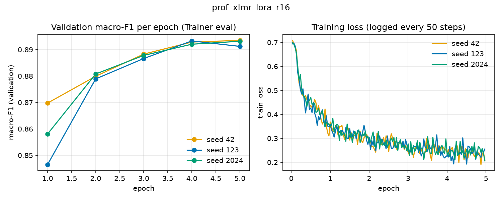
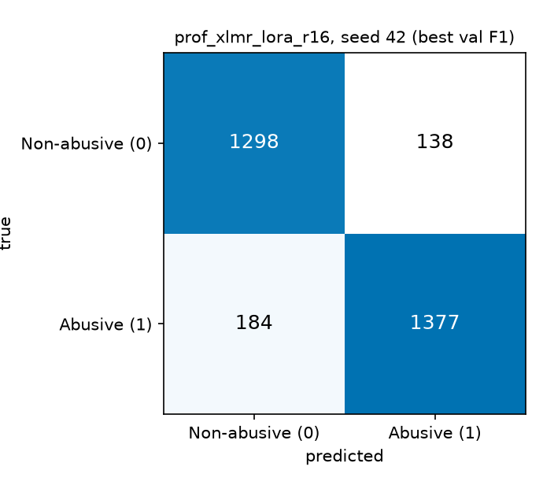

# prof_xlmr_lora_r16 (professor's recommended start config)

| Field | Value |
|---|---|
| Experiment | extra |
| Status | complete - 3 seed(s) [42, 123, 2024] |
| n seeds | 3 |
| Backbone | `FacebookAI/xlm-roberta-base` (xlm-roberta-base) |
| Method | LoRA |
| Config | lr=0.0002, epochs=5, r=16, alpha=32 |

## 2. Goal

LoRA freezes W and learns a low-rank update W + BA on the query and value projections (B in R^{d_out x r}, A in R^{r x d_in}); the effective update is scaled by alpha/r.

Question answered: how much macro-F1 does a LoRA adapter with r=16, alpha=32 on query/value keep relative to full fine-tuning?

## 3. Architecture end-to-end

```text
Telugu text (raw)
  |  normalize_text('normalized'): NFC -> mask URLs & @mentions -> collapse spaces  [src/data_utils.py]
  v
Tokenizer, truncation to max_length=128  [src/train.py]
  |
  v
Embeddings: word + position (250,002 x 768)      [frozen]
  |
  v
Encoder layer x12:
    self-attn query (q):  frozen W + TRAINABLE LoRA A,B  (targets: query,value)
    self-attn key   (k):  frozen
    self-attn value (v):  frozen W + TRAINABLE LoRA A,B
    self-attn out   (o):  frozen
    FFN 768->3072->768:    frozen
    LayerNorm:            frozen
  |
  v
<s> token (no pooler)
  |
  v
head: dense(768->768) + out_proj(768->2)  [TRAINABLE (modules_to_save)]
  |
  v
2 logits -> softmax -> argmax -> Non-abusive (0) / Abusive (1)
```

Adapter formula (q,v with d_in = d_out = hidden = 768):
- LoRA: `layers x targets x r x (d_in + d_out)`
- DoRA: LoRA + `layers x targets x d_out` (magnitude vector)
- AdaLoRA: `layers x targets x init_r x (d_in + d_out + 1)`, init_r = r*3//2 (train.py) or adapter_config.json init_r
- Head (modules_to_save): RoBERTa-type `h*h+h + h*2+2`; BERT-type `h*2+2`; num_labels=2

| Architecture | Value | Source |
|---|---|---|
| layers | 12 | AutoConfig.num_hidden_layers |
| hidden size | 768 | AutoConfig.hidden_size |
| attention heads | 12 | AutoConfig.num_attention_heads |
| FFN intermediate | 3072 | AutoConfig.intermediate_size |
| vocab size | 250,002 | AutoConfig.vocab_size |
| max positions | 514 | AutoConfig.max_position_embeddings |

Parameter counts across seeds identical: OK.

| Parameters | Value | Source |
|---|---|---|
| total params (metrics.json total_params) | 279,227,140 | metrics.json |
| trainable params | 1,181,954 | metrics.json |
| trainable % | 0.4233 | metrics.json |
| frozen = total - trainable | 278,045,186 | derived |
| adapter params (formula) | 589,824 | formula above |
| head params (formula) | 592,130 | formula above |
| adapter + head vs trainable | OK | formula check |

## 4. Training setup

| Setting | Value | Source |
|---|---|---|
| learning rate | 0.0002 | metrics.json hyperparams.lr |
| epochs (configured) | 5 | CSV / metrics.json |
| train batch size | 16 | metrics.json hyperparams.train_bs |
| eval batch size | 64 | training_args.bin |
| max_length | 128 | metrics.json hyperparams.max_length |
| optimizer | adamw_torch | training_args.bin (HF Trainer default; train.py does not set it) |
| weight decay | 0.01 | training_args.bin (train.py sets 0.01) |
| LR schedule | cosine | training_args.bin / metrics.json |
| warmup steps | 749 | training_args.bin (train.py: 10% of total steps, see below) |
| fp16 | True | training_args.bin (train.py: fp16 = CUDA available unless --fp16) |
| early stopping patience | 3 | metrics.json hyperparams |
| grad clip (max_grad_norm) | 1.0 | training_args.bin |
| LoRA r / alpha / dropout | 16 / 32 / 0.1 | metrics.json hyperparams |
| target modules | query,value | metrics.json hyperparams.target_modules |
| preprocessing | not recorded in metrics.json | train.py default --preprocess normalized |

Warmup and schedule code: `src/train.py` line ~208 sets warmup_steps = max(1, int(0.1 * total_steps)); line 237 sets weight_decay=0.01; line 239 uses lr_scheduler_type=args.lr_scheduler (default cosine).

## 5. What happened

| seed | best epoch | epochs run / configured | early stop | val macro-F1 | test macro-F1 | train time (s) | peak GPU (MB) |
|---|---|---|---|---|---|---|---|
| 42 | 5 | 5 / 5 | no | 0.8935 | 0.8925 | 423.5 | 1914.9 |
| 123 | 4 | 5 / 5 | no | 0.8933 | 0.8989 | 465.9 | 1914.4 |
| 2024 | 5 | 5 / 5 | no | 0.8932 | 0.8945 | 471.5 | 1916.0 |

Early stopping (epochs run < configured) triggered in 0 of 3 seeds. Epochs run is the last epoch with a Trainer eval entry in log_history.json.



Left: validation macro-F1 per epoch (Trainer eval entries, all seeds). Right: training loss from log_history.json (logged every 50 steps), x-axis in epochs.

## 6. Results

| Metric (test set, mean ± sample std over seeds) | Value |
|---|---|
| accuracy | 0.8953 ± 0.0032 |
| abusive precision | 0.9124 ± 0.0086 |
| abusive recall | 0.8840 ± 0.0051 |
| abusive F1 | 0.8980 ± 0.0027 |
| non-abusive F1 | 0.8926 ± 0.0039 |
| macro-F1 (from CM) | 0.8953 ± 0.0033 |
| weighted-F1 (from CM) | 0.8954 ± 0.0032 |

Consistency: CM-derived macro-F1 vs metrics.json test_macro_f1 per seed: OK, OK, OK.

| seed | test n | TN | FP (pred Abusive, true not) | FN (pred not, true Abusive) | TP | FP/FN |
|---|---|---|---|---|---|---|
| 42 | 2997 | 1298 | 138 | 184 | 1377 | 0.750 |
| 123 | 2997 | 1320 | 116 | 187 | 1374 | 0.620 |
| 2024 | 2997 | 1292 | 144 | 172 | 1389 | 0.837 |

Error counts (mean over seeds): FP = 132.7, FN = 181.0, FP/FN = 0.733. Class 1 = Abusive, confusion matrix layout [[TN,FP],[FN,TP]].

Confusion matrix, seed 42 (highest validation macro-F1 = 0.8935):



## 7. Compared with baseline

| metric | LoRA (this) | full FT (same backbone) | diff (this - full) | |diff| vs max(std) |
|---|---|---|---|---|
| test macro-F1 | 0.8953 ± 0.0033 | 0.9057 ± 0.0033 | -0.0104 | outside seed noise |
| val macro-F1 | 0.8933 ± 0.0002 | 0.9040 ± 0.0011 | -0.0107 | outside seed noise |

| ratio | value |
|---|---|
| trainable params: this / full | 0.0043 (1,181,954 / 278,045,186) |
| peak GPU memory: this / full | 0.358 (1915 MB / 5353 MB) |
| training time: this / full (mean) | 0.290 (454 s / 1564 s) |

Std-based noise rule: 'within seed noise' if |mean diff| < max(std_this, std_full). Sample std (n-1).

## 8. Interpretation

- Test macro-F1 mean 0.8953 over 3 seed(s) (std 0.0033).
- Seed with the highest validation macro-F1: 42 (val 0.8935, test 0.8925).
- Best epochs by seed: 5, 4, 5.
- Hypothesis (not tested): the adapter capacity limits how closely LoRA-type runs track full fine-tuning on this data; the diffs in section 7 are the only evidence here.

## 9. Spec alignment

| parameter | ours | paper Table 2 | professor start | match? |
|---|---|---|---|---|
| LoRA rank r | 16 | 4 | 16 | paper: no; prof: yes |
| LoRA alpha | 32 | 32 | 32 | paper: yes; prof: yes |
| LoRA dropout | 0.1 | 0.1 | 0.1 | paper: yes; prof: yes |
| train batch size | 16 | 8 | 16 | paper: no; prof: yes |
| max_length | 128 | 128 | 128 | paper: yes; prof: yes |
| epochs (configured) | 5 | 5 | 5 | paper: yes; prof: yes |
| learning rate | 0.0002 | not specified | 0.0002 | paper: n/a (not in spec); prof: yes |
| optimizer | adamw_torch | AdamW | not specified | paper: yes; prof: n/a (not in spec) |
| fp16 | True | True | not specified | paper: yes; prof: n/a (not in spec) |
| target modules | query,value | query,value | not specified | paper: yes; prof: n/a (not in spec) |
| weight decay | 0.01 | not specified | 0.01 | paper: n/a (not in spec); prof: yes |

Paper and professor values come from the project spec, not from run artifacts. Paper lr is not specified in the spec.

## 10. Limitations and artifact paths

- Seeds: 3 (42, 123, 2024). Std is over these seeds only; n=1 means no std.
- Single dataset split from train.py / data_utils.py; test size is the sum of the CM (see section 6).
- 'Peak GPU MB' and training time are from one GPU environment; hardware is not recorded in the artifacts.
- Preprocessing level is not recorded in metrics.json; the train.py default is 'normalized'.
- Parameter counts: trainable_params is the count at initialisation for AdaLoRA (final pruned ranks are not recorded).
- Regenerate with `.venv\Scripts\python -I src/model_reports.py`.

Artifacts:

- `results/study/prof_xlmr_lora_r16_a32_s42/` (metrics.json, log_history.json, model/)
- `results/study/prof_xlmr_lora_r16_a32_s123/` (metrics.json, log_history.json, model/)
- `results/study/prof_xlmr_lora_r16_a32_s2024/` (metrics.json, log_history.json, model/)
- `results/study/study_results.csv`
- `docs/models/figures/prof_xlmr_lora_r16_curves.png`, `docs/models/figures/prof_xlmr_lora_r16_cm.png`

